# Initial Effects

Guía de referencia de los 16 Initial Effects: qué dice cada carta, qué hace hoy el motor, qué casos están definidos y cuáles siguen sin decidir.

- Fuente: `packages/game_engine` (rama `dev`). Los comentarios de `InitialEffectKind` traducen el texto del manual; `GameMatch.useInitialEffect` documenta las habilidades activas.
- Imagen de cada carta: `assets/cards/<id>.jpg`. Los nombres de los tests están en inglés, como en `packages/game_engine/test/match/`.

## Estados de cada caso

- **Manual:** lo dice el texto de la carta o el manual de Orlando.
- **Decidido:** está escrito en `CLAUDE.md` como decisión o interpretación del equipo. Las interpretaciones de los pasivos siguen pendientes de validar con Orlando.
- **Implementado sin validar:** el motor lo hace así, pero nadie lo decidió; es consecuencia de cómo se programó.
- **Sin definir:** nadie lo ha definido y el motor puede no cubrirlo bien. Es una pregunta abierta.

La columna **En el código** dice si el motor (`packages/game_engine`) ya hace lo que describe el caso. Se marcó leyendo el código y después se verificó: `flutter test` pasa (197 tests en `packages/game_engine`, 22 en la raíz) y `flutter analyze` no reporta problemas. Pasar los tests no prueba que cada caso esté cubierto, así que cada caso se revisó además leyendo el código del motor. "Sí" significa que el motor lo hace, aunque la pantalla de partida aún no tenga botón para las habilidades activas; "Sin decisión" significa que no hay regla definida (debajo se anota lo que hace hoy el motor); "Inalcanzable" significa que la comprobación existe en el código, pero ninguna jugada real llega a ella. Un caso de la interfaz (Tolerance, pantalla de partida) se cumple en `lib/`, no en el motor.

La columna **Test** dice si hay un test automático con nombre propio que cubra el caso. "No" no significa que esté mal: significa que nada lo vigila.

## Reglas comunes

- Una habilidad activa se usa **una vez por partida**, en la fase de jugar. La excepción es Commitment, que se usa después de perder un Clash.
- Una jugada no permitida se rechaza con un motivo (fase incorrecta, ya usada, sin habilidad activa, sin objetivo válido o elección inválida). `checkUseInitialEffect` permite que la interfaz desactive el botón.
- **Empathy** copia el Initial Effect del rival (pasivo y activo). Si ambos tienen Empathy, ninguno copia nada.
- Cada Trophy Stack solo guarda cartas del rival y cada Discard Stack solo cartas propias. Una carta prestada (Generosity) vuelve al Discard Stack de su dueño.
- Un Effect del rival que impide jugar cartas no cancela lo que ya está en juego. Commitment no puede ser impedido por ningún Effect.
- Los pasivos actúan solos. Las habilidades activas todavía no tienen botón en la pantalla de partida ni las usa el rival del sistema.

## Resumen

| Initial Effect | Tipo | Cuándo actúa | Casos sin decisión |
|---|---|---|---|
| Recycle | Activa | Fase de jugar (durante el Clash, antes de resolverlo). Una vez por partida. | 4 de 7 |
| Diversity | Pasiva | Durante toda la partida, al calcular el Power en cada Clash. | 1 de 4 |
| Tolerance | Pasiva | Cuando una Creature del jugador es derrotada. | 1 de 5 |
| Responsibility | Pasiva y activa | Pasiva: toda la partida. Activa: fase de jugar, una vez por partida. | 3 de 8 |
| Respect | Pasiva | Al resolver un Clash que termina en Tie por Class. | 1 de 4 |
| Loyalty | Activa | Fase de jugar. Una vez por partida. | 4 de 5 |
| Leadership | Activa | Fase de jugar. Una vez por partida. | 2 de 5 |
| Kindness | Activa | Fase de jugar. Una vez por partida. | 3 de 4 |
| Justice | Pasiva | Al calcular el Power de la siguiente Creature. | 0 de 2 |
| Honesty | Activa | Fase de jugar. Una vez por partida. | 4 de 5 |
| Generosity | Activa | Fase de jugar. Una vez por partida. | 7 de 7 |
| Friendship | Pasiva | Al calcular el Power después de un Tie. | 0 de 2 |
| Excellence | Pasiva | Al calcular el Power después de ganar un Clash. | 0 de 3 |
| Empathy | Pasiva (copia) | Toda la partida. | 1 de 4 |
| Creativity | Activa | Fase de jugar. Una vez por partida. | 5 de 6 |
| Commitment | Activa | Solo después de perder un Clash (fase posterior al Clash). Una vez por partida. | 5 de 10 |

## Fichas

### Recycle

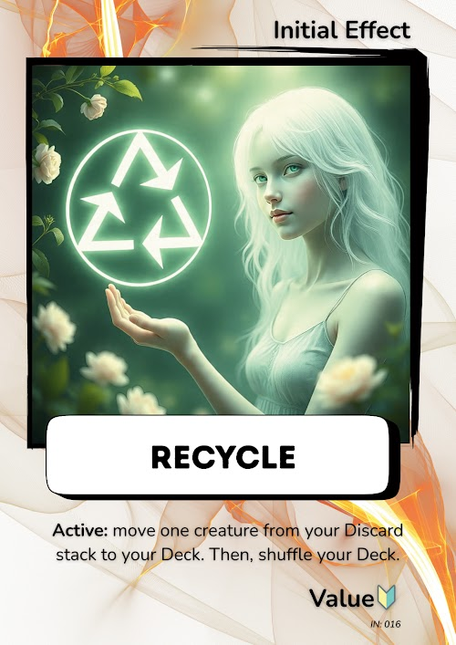

- **Tipo:** Activa
- **Cuándo:** Fase de jugar (durante el Clash, antes de resolverlo). Una vez por partida.
- **Texto del manual (traducción):** Mueve una Creature desde tu Discard Stack a tu Deck. Luego, baraja tu Deck.

**Qué hace el motor**

- El jugador elige una Creature de su propio Discard Stack. Esa carta sale del Discard Stack y entra al Deck, y el Deck se baraja con el generador aleatorio de la partida.

**Casos**

| Caso | Estado | En el código | Test |
|---|---|---|---|
| Mueve una Creature del Discard Stack propio al Deck y baraja el Deck | Manual | Sí | Sí |
| Solo se mueve la Creature elegida. Si tenía un Item equipado y el Item está en el Discard Stack, el Item se queda ahí | Implementado sin validar | Sí | No |
| Si el Discard Stack no tiene Creatures, no se puede usar | Implementado sin validar | Sí | Sí |
| Si la elección no es una de las opciones ofrecidas, la jugada se rechaza | Implementado sin validar | Sí | Sí |
| Si ya la usó en la partida, se rechaza | Decidido | Sí | Sí |
| Fuera de la fase de jugar, se rechaza | Implementado sin validar | Sí | Sí |
| Un jugador con Empathy frente a un rival con Recycle también puede usarla | Decidido | Sí | Sí |

**Tests que lo cubren**

- `offers the creatures of the own discard stack`
- `moves the chosen creature from the discard stack to the deck`
- `can only be used once per game`
- `is not usable while the discard stack has no creatures`
- `rejects a choice that is not an option`
- `works for a player with Empathy facing Recycle`
- `the deck is shuffled with the match random`

**Dudas para confirmar con Orlando**

- ¿Recycle devuelve solo la Creature o también su Item? Hoy el Item se queda en el Discard Stack, pero Loyalty sí devuelve la Creature con su Item.

### Diversity

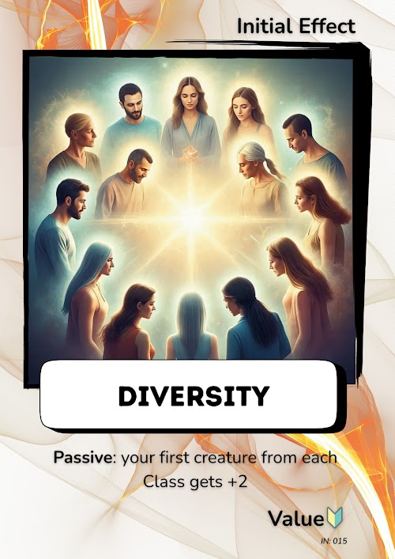

- **Tipo:** Pasiva
- **Cuándo:** Durante toda la partida, al calcular el Power en cada Clash.
- **Texto del manual (traducción):** Tu primera Creature de cada Class obtiene +2 de Power.

**Qué hace el motor**

- La primera Creature de cada Class que entra en juego tiene +2 de Power mientras siga en la mesa.
- Las siguientes Creatures de esa misma Class no reciben el bono.

**Casos**

| Caso | Estado | En el código | Test |
|---|---|---|---|
| La primera Creature de cada Class en entrar en juego tiene +2 de Power; las siguientes de esa Class, no | Manual | Sí | Sí |
| Con Creatures de Class distintas, cada una recibe +2 (cada una es la primera de su Class) | Decidido | Sí | No |
| Si la Creature tiene Duration y sigue en la mesa, conserva el +2 mientras siga ahí | Decidido | Sí | No |
| Si un Effect le agrega una Class a una Creature, no se sabe si cuenta como primera de esa Class *(Hoy no cuenta: el motor usa solo la Class impresa de la carta.)* | Sin definir | Sin decisión | No |

**Tests que lo cubren**

- `the first creature of each class gets +2; the next ones do not`

**Dudas para confirmar con Orlando**

- Interpretación pendiente (CLAUDE.md): ¿el bono dura mientras la Creature sigue en la mesa o solo en su primer Clash?
- ¿Una Class agregada por un Effect cuenta para Diversity?

### Tolerance

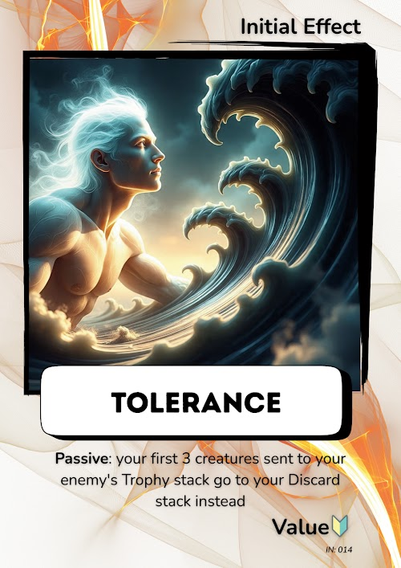

- **Tipo:** Pasiva
- **Cuándo:** Cuando una Creature del jugador es derrotada.
- **Texto del manual (traducción):** Tus primeras 3 Creatures derrotadas, en vez de ir al Trophy Stack del enemigo, van a tu Discard Stack.

**Qué hace el motor**

- Las primeras 3 Creatures derrotadas del jugador van a su propio Discard Stack, con sus Items, y no son trofeo del rival.
- Desde la cuarta derrota, vuelven a ir al Trophy Stack del rival.

**Casos**

| Caso | Estado | En el código | Test |
|---|---|---|---|
| Las primeras 3 Creatures derrotadas del jugador van a su propio Discard Stack y no son trofeo del rival | Manual | Sí | Sí |
| Desde la cuarta derrota, las Creatures vuelven a ir al Trophy Stack del rival | Manual | Sí | Sí |
| El Item equipado acompaña a su Creature al Discard Stack | Decidido | Sí | Sí |
| Cuentan todas las derrotas, también las que ocurren al resolver un Tie | Decidido | Sí | No |
| La pantalla de partida explica cuándo Tolerance evita un trofeo *(Se cumple en la interfaz, en `lib/features/match/presentation/match_controller.dart`, no en el motor.)* | Implementado sin validar | Sí | No |

**Tests que lo cubren**

- `the first 3 defeated creatures go to their own discard stack`
- `trophy_invariant_test (el Trophy Stack solo guarda cartas del rival)`

**Dudas para confirmar con Orlando**

- Interpretación pendiente (CLAUDE.md): ¿cuentan también las derrotas dentro de un Tie?

### Responsibility

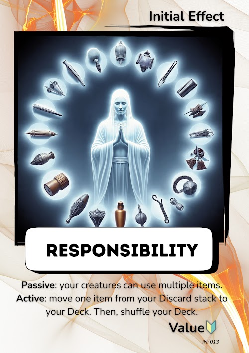

- **Tipo:** Pasiva y activa
- **Cuándo:** Pasiva: toda la partida. Activa: fase de jugar, una vez por partida.
- **Texto del manual (traducción):** Pasiva: tus Creatures pueden usar múltiples Items. Activa: mueve un Item desde tu Discard Stack a tu Deck. Luego, baraja tu Deck.

**Qué hace el motor**

- Pasiva: no hay límite de Items por Creature. Cada Item suma su Power; de Rarity y Duration se queda la mayor.
- Activa: el jugador elige un Item de su Discard Stack, que vuelve al Deck, y el Deck se baraja.

**Casos**

| Caso | Estado | En el código | Test |
|---|---|---|---|
| Pasiva: sin límite de Items por Creature; cada Item suma su Power | Decidido | Sí | Sí |
| Pasiva: de Rarity se queda con la mayor entre la Creature y sus Items | Decidido | Sí | Sí |
| Pasiva: de Duration se queda con la mayor | Decidido | Sí | No |
| Sin Responsibility, una Creature solo puede llevar un Item | Decidido | Sí | Sí |
| Activa: mueve un Item del Discard Stack propio al Deck y baraja el Deck | Manual | Sí | Sí |
| Activa: solo ofrece Items; elegir una Creature se rechaza | Implementado sin validar | Sí | Sí |
| Activa: solo vuelve el Item elegido, aunque su Creature siga en el Discard Stack | Implementado sin validar | Sí | Sí |
| Activa: si el Discard Stack no tiene Items, no se puede usar | Implementado sin validar | Sí | No |

**Tests que lo cubren**

- `a creature can carry several items`
- `offers only the items of the discard stack`
- `moves the chosen item from the discard stack to the deck`
- `rejects a creature of the discard stack`
- `Responsibility has both a passive and an active ability`

**Dudas para confirmar con Orlando**

- Interpretación pendiente (CLAUDE.md): con varios Items, Power suma y Rarity y Duration se quedan con la mayor.
- Activa: ¿el Item vuelve solo, aunque su Creature siga en el Discard Stack?

### Respect

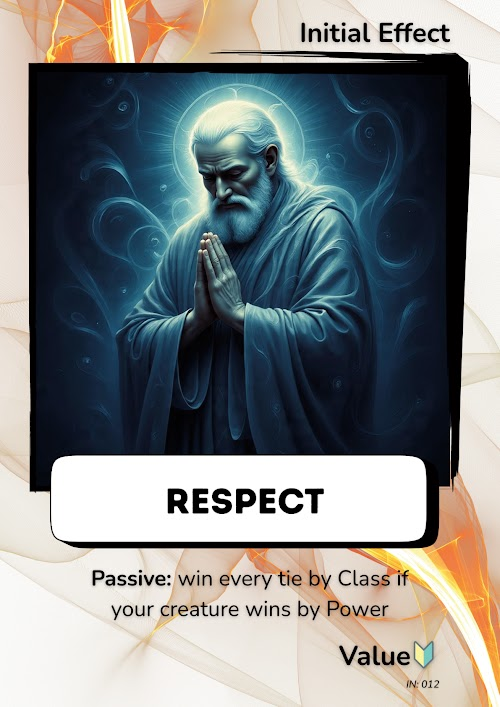

- **Tipo:** Pasiva
- **Cuándo:** Al resolver un Clash que termina en Tie por Class.
- **Texto del manual (traducción):** Gana todos los empates por Class si tu Creature gana por Power.

**Qué hace el motor**

- Si el Clash sería Tie porque las dos Creatures comparten Class y la Creature del jugador con Respect tiene más Power, la gana por Power.

**Casos**

| Caso | Estado | En el código | Test |
|---|---|---|---|
| En un Tie por Class, si su Creature tiene más Power, gana por Power | Manual | Sí | Sí |
| Si su Creature tiene menos Power, no ayuda: sigue siendo Tie | Decidido | Sí | Sí |
| Con el mismo Power sigue siendo Tie | Decidido | Sí | Sí |
| No cambia los Clashes que no son Tie por Class | Implementado sin validar | Sí | No |

**Tests que lo cubren**

- `a tie by class is won by the creature with more power`
- `it does not help the creature with less power`
- `with the same power it is still a tie`

**Dudas para confirmar con Orlando**

- Interpretación pendiente (CLAUDE.md): con el mismo Power sigue siendo Tie.

### Loyalty

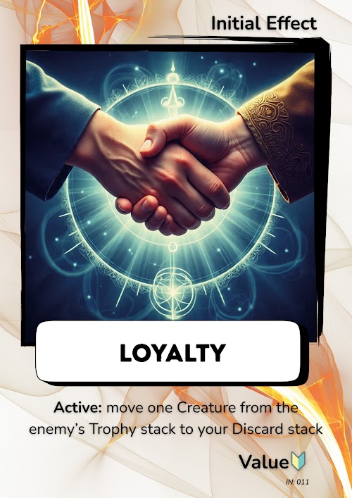

- **Tipo:** Activa
- **Cuándo:** Fase de jugar. Una vez por partida.
- **Texto del manual (traducción):** Mueve una Creature desde el Trophy Stack del enemigo a tu Discard Stack.

**Qué hace el motor**

- El jugador elige una Creature suya que esté en el Trophy Stack del rival (una que perdió). Vuelve a su Discard Stack junto con sus Items, y el rival pierde esos trofeos.

**Casos**

| Caso | Estado | En el código | Test |
|---|---|---|---|
| Mueve una Creature propia del Trophy Stack del rival al Discard Stack propio; el rival pierde ese trofeo | Manual | Sí | Sí |
| La Creature vuelve con sus Items | Implementado sin validar | Sí | Sí |
| Si el rival le robó el Item con Kindness, el Item no vuelve | Implementado sin validar | Sí | Sí |
| Si el Trophy Stack del rival no tiene Creatures suyas, no se puede usar | Implementado sin validar | Sí | Sí |
| Si elige una carta que no es una de esas Creatures, se rechaza | Implementado sin validar | Sí | Sí |

**Tests que lo cubren**

- `is not usable while the rival trophy stack has no creatures`
- `brings a lost creature and its item back to the own discard`
- `leaves behind an item that the rival took with Kindness`
- `rejects a card that is not a creature of the rival trophy stack`

**Dudas para confirmar con Orlando**

- ¿Es intencional que Loyalty devuelva la Creature con su Item y Recycle no?

### Leadership

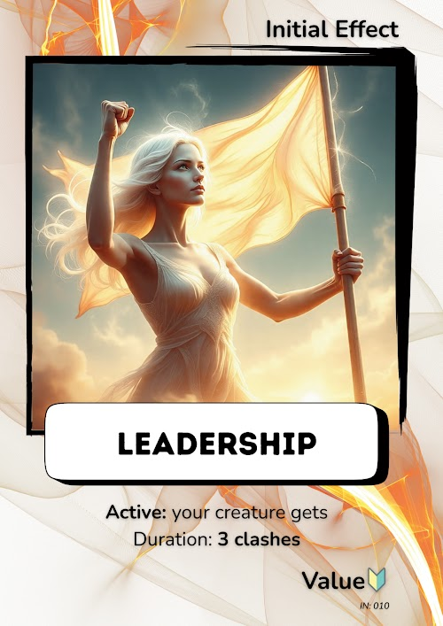

- **Tipo:** Activa
- **Cuándo:** Fase de jugar. Una vez por partida.
- **Texto del manual (traducción):** Tu Creature obtiene Duración: 3 Clashes.

**Qué hace el motor**

- La Creature en la mesa queda con Duration de 3 Clashes, contando el actual.
- Si ya tenía una Duration mayor, la conserva (nunca empeora).

**Casos**

| Caso | Estado | En el código | Test |
|---|---|---|---|
| La Creature en la mesa queda con Duration de 3 Clashes, contando el actual | Implementado sin validar | Sí | Sí |
| Si ya tenía una Duration mayor, la conserva | Decidido | Sí | Sí |
| Se mantiene 3 Clashes y después va al Discard Stack de su dueño | Decidido | Sí | Sí |
| Si pierde antes de completar la Duration, va al Trophy Stack del rival | Decidido | Sí | No |
| Si no hay Creature en la mesa, no se puede usar *(La comprobación existe, pero ninguna jugada real llega a ella: en la fase de jugar siempre hay Creature, y fuera de ella se rechaza antes por fase incorrecta. No lleva test.)* | Implementado sin validar | Inalcanzable | No |

**Tests que lo cubren**

- `keeps the creature in play for 3 clashes`
- `does not worsen a creature with a longer duration`
- `can only be used once per game`

**Dudas para confirmar con Orlando**

- ¿"Duración: 3 Clashes" cuenta el Clash en que se usa? Hoy sí.

### Kindness

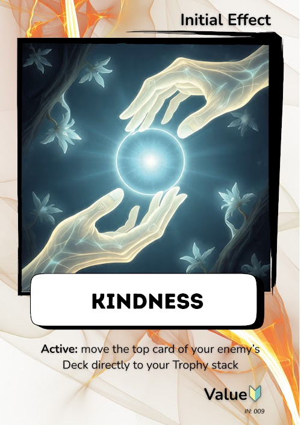

- **Tipo:** Activa
- **Cuándo:** Fase de jugar. Una vez por partida.
- **Texto del manual (traducción):** Mueve la carta superior del Deck de tu enemigo directamente a tu Trophy Stack.

**Qué hace el motor**

- La carta superior del Deck del rival pasa a su Trophy Stack del jugador, sea del tipo que sea.

**Casos**

| Caso | Estado | En el código | Test |
|---|---|---|---|
| La carta superior del Deck rival pasa directo al Trophy Stack propio | Manual | Sí | Sí |
| Cuenta como trofeo cualquier tipo de carta (Creature, Item o Effect) | Implementado sin validar | Sí | No |
| Si el Deck del rival está vacío, no se puede usar | Implementado sin validar | Sí | Sí |
| Si era la última carta del rival, la partida termina en el siguiente Clash | Implementado sin validar | Sí | Sí |

**Tests que lo cubren**

- `moves the top card of the rival deck to the own trophy stack`
- `is not usable if the rival deck is empty`
- `taking the last card ends the game at the next reveal`

**Dudas para confirmar con Orlando**

- ¿Cualquier carta robada cuenta como trofeo, o solo las Creatures?

### Justice

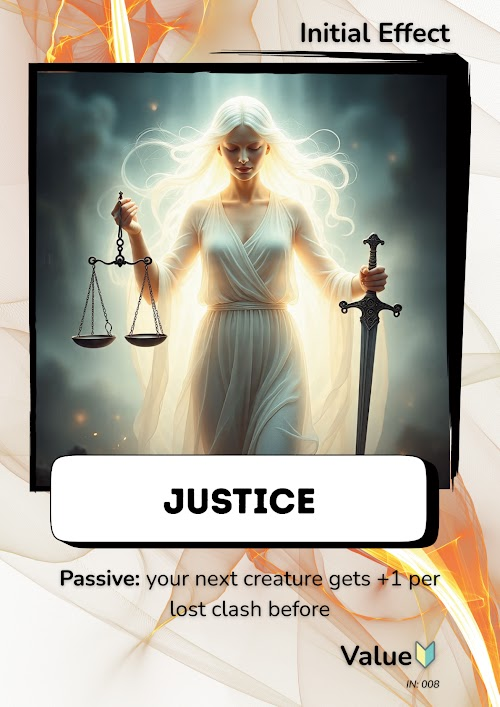

- **Tipo:** Pasiva
- **Cuándo:** Al calcular el Power de la siguiente Creature.
- **Texto del manual (traducción):** Tu siguiente Creature obtiene +1 por cada Clash perdido anteriormente (se reinicia al ganar un Clash).

**Qué hace el motor**

- +1 de Power por cada Clash perdido desde la última victoria. El contador se reinicia al ganar un Clash.

**Casos**

| Caso | Estado | En el código | Test |
|---|---|---|---|
| +1 de Power por cada Clash perdido desde la última victoria; el contador se reinicia al ganar | Manual | Sí | Sí |
| Un Tie no suma ni reinicia el contador | Decidido | Sí | No |

**Tests que lo cubren**

- `+1 for each clash lost since the last win`

**Dudas para confirmar con Orlando**

- Interpretación pendiente (CLAUDE.md): los Ties no suman ni reinician.

### Honesty

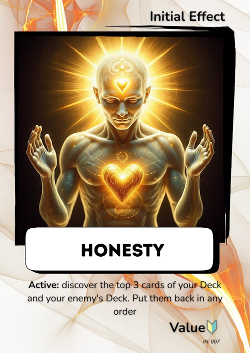

- **Tipo:** Activa
- **Cuándo:** Fase de jugar. Una vez por partida.
- **Texto del manual (traducción):** Revela las 3 cartas superiores de tu Deck y del Deck de tu enemigo. Luego, vuelve a colocarlas en cualquier orden.

**Qué hace el motor**

- El jugador ve las 3 cartas superiores de cada Deck y decide el nuevo orden de las de su Deck y de las del rival.

**Casos**

| Caso | Estado | En el código | Test |
|---|---|---|---|
| Se ven las 3 cartas superiores de cada Deck y se reordenan | Manual | Sí | Sí |
| Si un Deck tiene menos de 3 cartas, se reordenan las que tiene | Implementado sin validar | Sí | Sí |
| Si los dos Decks están vacíos, no se puede usar | Implementado sin validar | Sí | Sí |
| Si el nuevo orden no es una reordenación de las mismas cartas, se rechaza | Implementado sin validar | Sí | Sí |
| No se sabe si el rival también ve las cartas que se revelan *(Hoy el motor solo devuelve las cartas a quien la usa; el rival no recibe nada.)* | Sin definir | Sin decisión | No |

**Tests que lo cubren**

- `discovers the top 3 cards of both decks`
- `puts them back in the order the player chose`
- `rejects an order that is not a rearrangement of the cards`
- `works when a deck has fewer than 3 cards`
- `is not usable when both decks are empty`

**Dudas para confirmar con Orlando**

- ¿El rival también ve las cartas que se revelan?

### Generosity

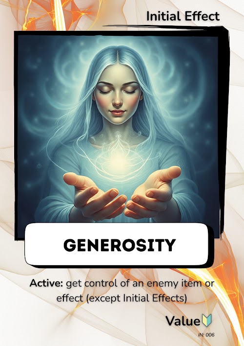

- **Tipo:** Activa
- **Cuándo:** Fase de jugar. Una vez por partida.
- **Texto del manual (traducción):** Toma control de un Item o Effect enemigo (excepto Initial Effects).

**Qué hace el motor**

- Implementación actual: el jugador elige un Item o Effect de la Hand del rival, que pasa a su Hand y se juega con las reglas de siempre.
- Sigue siendo del rival: al agotarse vuelve al Discard Stack de su dueño y nunca cuenta como trofeo.

**Casos**

| Caso | Estado | En el código | Test |
|---|---|---|---|
| El jugador elige un Item o Effect de la Hand del rival y lo pasa a su propia Hand | Implementado sin validar | Sí | Sí |
| La carta robada se juega con las reglas de siempre y sigue siendo del rival | Implementado sin validar | Sí | Sí |
| Un Item robado cuya Creature gana vuelve al Discard Stack de su dueño | Implementado sin validar | Sí | Sí |
| Un Item robado en una Creature derrotada no cuenta como trofeo | Implementado sin validar | Sí | Sí |
| Un Effect robado vuelve al Discard Stack de su dueño al agotarse o al terminar la partida | Implementado sin validar | Sí | Sí |
| Si la Hand del rival está vacía, no se puede usar; elegir una carta que no está ahí se rechaza | Implementado sin validar | Sí | Sí |
| No se sabe si se puede robar un Item o Effect que ya está en juego *(Hoy no se puede: solo se ofrecen cartas de la Hand del rival.)* | Sin definir | Sin decisión | No |

**Tests que lo cubren**

- `offers the items and effects of the rival hand`
- `moves the chosen card to the own hand, still owned by the rival`
- `the stolen item is equipped under the usual rules`
- `a stolen item that wins goes back to the discard of its owner`
- `a stolen item on a defeated creature is not a trophy`
- `a stolen effect returns to the discard of its owner when spent`
- `a stolen effect still in play when the match ends goes back too`

**Dudas para confirmar con Orlando**

- ¿Se puede robar solo de la Hand del rival, o también un Item o Effect que ya está en juego?
- ¿La carta robada debe volver a su dueño al agotarse (decisión actual)?

### Friendship

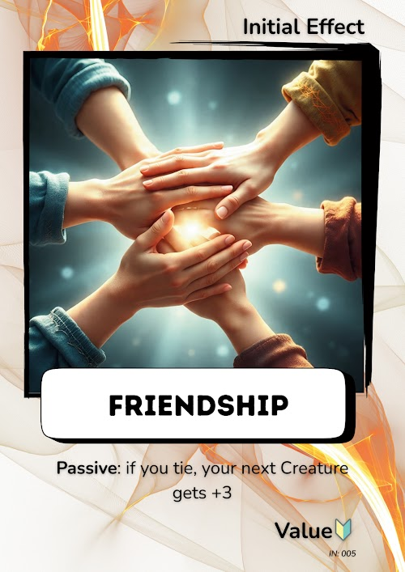

- **Tipo:** Pasiva
- **Cuándo:** Al calcular el Power después de un Tie.
- **Texto del manual (traducción):** Si empatas, tu siguiente Creature obtiene +3.

**Qué hace el motor**

- +3 de Power solo en el Clash que sigue a un Tie.

**Casos**

| Caso | Estado | En el código | Test |
|---|---|---|---|
| +3 de Power solo en el Clash que sigue a un Tie | Decidido | Sí | Sí |
| El bono no se acumula con varios Ties seguidos | Decidido | Sí | No |

**Tests que lo cubren**

- `+3 only in the clash after a tie`

**Dudas para confirmar con Orlando**

- Interpretación pendiente (CLAUDE.md): no se acumula con varios Ties seguidos.

### Excellence

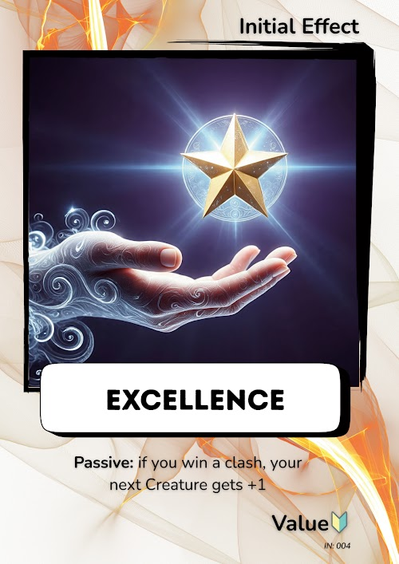

- **Tipo:** Pasiva
- **Cuándo:** Al calcular el Power después de ganar un Clash.
- **Texto del manual (traducción):** Si ganas un Clash, tu siguiente Creature obtiene +1.

**Qué hace el motor**

- +1 de Power solo en el Clash que sigue a una victoria.

**Casos**

| Caso | Estado | En el código | Test |
|---|---|---|---|
| +1 de Power solo en el Clash que sigue a una victoria | Decidido | Sí | Sí |
| Aplica aunque pelee la misma Creature | Decidido | Sí | No |
| Si en el Clash siguiente pierde o empata, el bono no se mantiene | Decidido | Sí | No |

**Tests que lo cubren**

- `+1 in the clash after a win`

**Dudas para confirmar con Orlando**

- Interpretación pendiente (CLAUDE.md): aplica aunque pelee la misma Creature.

### Empathy

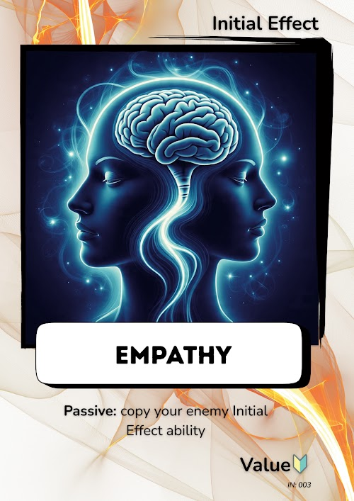

- **Tipo:** Pasiva (copia)
- **Cuándo:** Toda la partida.
- **Texto del manual (traducción):** Copia la habilidad de Initial Effect de tu enemigo.

**Qué hace el motor**

- Copia las habilidades pasivas del Initial Effect del rival.
- Si el rival tiene una habilidad activa, también la copia y la puede usar una vez.
- Si ambos jugadores tienen Empathy, ninguno copia nada.

**Casos**

| Caso | Estado | En el código | Test |
|---|---|---|---|
| Copia las habilidades pasivas del Initial Effect del rival | Manual | Sí | Sí |
| Copia también la habilidad activa del rival y la puede usar una vez | Decidido | Sí | Sí |
| Si el rival solo tiene habilidad pasiva, no hay habilidad activa que copiar | Implementado sin validar | Sí | Sí |
| Si los dos jugadores tienen Empathy, ninguno copia nada | Decidido | Sí | Sí |

**Tests que lo cubren**

- `copies the passive ability of the rival initial effect`
- `two players with Empathy copy nothing`
- `Empathy copies the active ability of the rival`
- `Empathy copies nothing if the rival has only a passive ability`
- `Empathy copies nothing if both players have Empathy`

**Dudas para confirmar con Orlando**

- Interpretación pendiente (CLAUDE.md): copia pasiva y activa, y la activa se usa una vez.
- ¿Qué pasa con Empathy contra Empathy? Hoy ninguno copia nada.

### Creativity

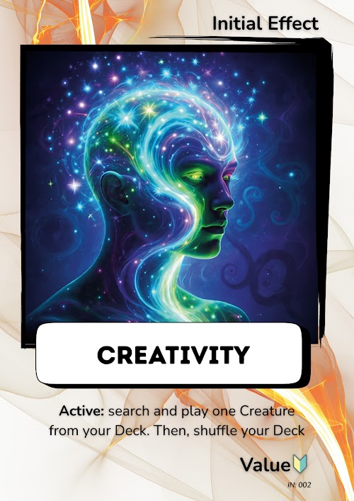

- **Tipo:** Activa
- **Cuándo:** Fase de jugar. Una vez por partida.
- **Texto del manual (traducción):** Busca y juega una Creature desde tu Deck. Luego, baraja tu Deck.

**Qué hace el motor**

- El jugador elige una Creature de su Deck y la juega en lugar de la que está en la mesa.
- La Creature reemplazada va con su Item a su Discard Stack, sin ser trofeo. Luego se baraja el Deck.
- La nueva Creature pelea el Clash actual y puede ganarlo.

**Casos**

| Caso | Estado | En el código | Test |
|---|---|---|---|
| Elige una Creature del Deck, la juega y baraja el Deck | Manual | Sí | Sí |
| La Creature reemplazada va con su Item al Discard Stack, sin ser trofeo | Implementado sin validar | Sí | Sí |
| La Creature nueva pelea el Clash actual y puede ganarlo | Implementado sin validar | Sí | Sí |
| Solo se ofrecen Creatures del Deck; sin Creatures, no se puede usar | Implementado sin validar | Sí | Sí |
| Si un Effect del rival saca a la nueva Creature, se revela otra; si no queda nada, la partida termina | Implementado sin validar | Sí | Sí |
| No se sabe si el Item de la Creature reemplazada debería pasar a la nueva *(Hoy el Item se va al Discard Stack con la Creature reemplazada.)* | Sin definir | Sin decisión | No |

**Tests que lo cubren**

- `offers only the creatures of the own deck`
- `plays the chosen creature in place of the one on the table`
- `the replaced creature and its item are not trophies`
- `the new creature fights the clash, which it can win`
- `rejects an item of the deck and a creature that is not there`
- `is not usable if the deck has no creatures`
- `reveals another creature if the chosen one is removed`
- `ends the game if there is nothing left to reveal`

**Dudas para confirmar con Orlando**

- ¿El Item de la Creature reemplazada debería pasar a la nueva?

### Commitment

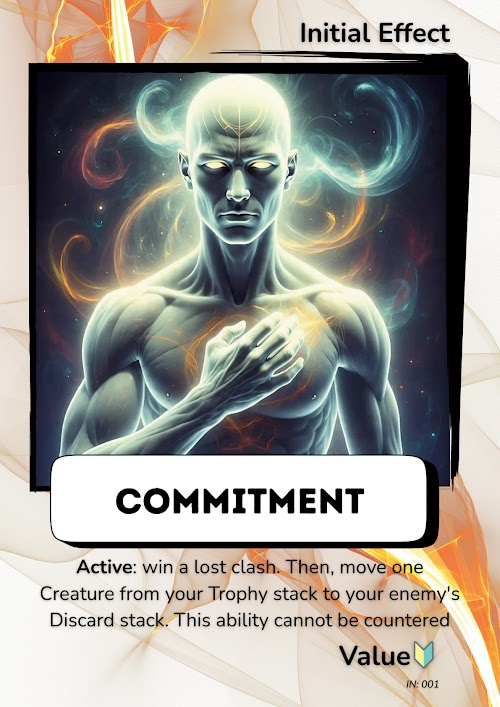

- **Tipo:** Activa
- **Cuándo:** Solo después de perder un Clash (fase posterior al Clash). Una vez por partida.
- **Texto del manual (traducción):** Gana un Clash perdido. Luego, mueve una Creature desde tu Trophy Stack al Discard Stack de tu enemigo. Esta habilidad no puede ser contrarrestada.

**Qué hace el motor**

- Cuando el jugador pierde un Clash, el Clash no se aplica todavía: puede usar Commitment o rechazarlo.
- Si la usa, gana el Clash (motivo: Commitment) y mueve una Creature de su Trophy Stack, con sus Items, al Discard Stack del rival.
- Ningún Effect del rival puede impedirlo.

**Casos**

| Caso | Estado | En el código | Test |
|---|---|---|---|
| Quien pierde un Clash puede usar Commitment y gana ese Clash | Manual | Sí | Sí |
| Mueve una Creature de su Trophy Stack, con sus Items, al Discard Stack del rival | Implementado sin validar | Sí | Sí |
| Si no tiene Creatures que mover, solo gana el Clash | Implementado sin validar | Sí | Sí |
| Si tiene Creatures que mover, debe elegir una | Implementado sin validar | Sí | Sí |
| Si rechaza usarla, el Clash se aplica como se resolvió | Implementado sin validar | Sí | Sí |
| Si rechaza usarla, la habilidad sigue disponible para otro Clash | Implementado sin validar | Sí | No |
| Un Tie no abre la decisión, y el ganador del Clash no la recibe | Manual | Sí | Sí |
| Una vez usada, no se vuelve a ofrecer | Decidido | Sí | Sí |
| Con Empathy contra un rival con Commitment, también se puede usar | Decidido | Sí | Sí |
| Ningún Effect del rival puede impedirla | Manual | Sí | No |

**Tests que lo cubren**

- `opens a decision for the loser without applying the clash`
- `declining it applies the clash as it was resolved`
- `wins the lost clash, even with nothing to move`
- `moves a creature of the own trophy stack to the rival discard`
- `requires choosing a creature when there are any to move`
- `rejects a choice when there is nothing to move`
- `a tie does not open a decision`
- `the winner with Commitment does not get a decision`
- `it opens a decision only until it has been used`
- `works for a loser with Empathy facing Commitment`

**Dudas para confirmar con Orlando**

- ¿Se puede rechazar Commitment en un Clash y usarlo en otro?
- ¿Los Items de la Creature movida también van al Discard del rival? Hoy sí.

## Preguntas para Orlando

Reunidas desde las fichas.

**Recycle**

- ¿Recycle devuelve solo la Creature o también su Item? Hoy el Item se queda en el Discard Stack, pero Loyalty sí devuelve la Creature con su Item.

**Diversity**

- Interpretación pendiente (CLAUDE.md): ¿el bono dura mientras la Creature sigue en la mesa o solo en su primer Clash?
- ¿Una Class agregada por un Effect cuenta para Diversity?

**Tolerance**

- Interpretación pendiente (CLAUDE.md): ¿cuentan también las derrotas dentro de un Tie?

**Responsibility**

- Interpretación pendiente (CLAUDE.md): con varios Items, Power suma y Rarity y Duration se quedan con la mayor.
- Activa: ¿el Item vuelve solo, aunque su Creature siga en el Discard Stack?

**Respect**

- Interpretación pendiente (CLAUDE.md): con el mismo Power sigue siendo Tie.

**Loyalty**

- ¿Es intencional que Loyalty devuelva la Creature con su Item y Recycle no?

**Leadership**

- ¿"Duración: 3 Clashes" cuenta el Clash en que se usa? Hoy sí.

**Kindness**

- ¿Cualquier carta robada cuenta como trofeo, o solo las Creatures?

**Justice**

- Interpretación pendiente (CLAUDE.md): los Ties no suman ni reinician.

**Honesty**

- ¿El rival también ve las cartas que se revelan?

**Generosity**

- ¿Se puede robar solo de la Hand del rival, o también un Item o Effect que ya está en juego?
- ¿La carta robada debe volver a su dueño al agotarse (decisión actual)?

**Friendship**

- Interpretación pendiente (CLAUDE.md): no se acumula con varios Ties seguidos.

**Excellence**

- Interpretación pendiente (CLAUDE.md): aplica aunque pelee la misma Creature.

**Empathy**

- Interpretación pendiente (CLAUDE.md): copia pasiva y activa, y la activa se usa una vez.
- ¿Qué pasa con Empathy contra Empathy? Hoy ninguno copia nada.

**Creativity**

- ¿El Item de la Creature reemplazada debería pasar a la nueva?

**Commitment**

- ¿Se puede rechazar Commitment en un Clash y usarlo en otro?
- ¿Los Items de la Creature movida también van al Discard del rival? Hoy sí.

## Tests por mejorar

Casos con "Test = Sí" cuyo test no cubre todo lo que dice el caso. Se completan en la Tarea 2.

- **Commitment, "Mueve una Creature de su Trophy Stack, con sus Items, al Discard Stack del rival":** el test (`moves a creature of the own trophy stack to the rival discard`) no usa Items.
- **Commitment, "Si rechaza usarla, la habilidad sigue disponible para otro Clash":** `declining it applies the clash as it was resolved` solo comprueba que `hasUsedActive` sigue en falso; no comprueba que la decisión se vuelva a abrir en un Clash posterior.
- **Creativity, "Elige una Creature del Deck, la juega y baraja el Deck":** `plays the chosen creature in place of the one on the table` usa `unorderedEquals`, así que no verifica que el Deck se baraje.
- **Honesty, "Si un Deck tiene menos de 3 cartas, se reordenan las que tiene":** `works when a deck has fewer than 3 cards` solo llama a `checkUseInitialEffect`; no usa la habilidad con `useInitialEffect`.

## Qué falta

- Botón y selector de carta en la pantalla de partida para las 9 habilidades activas (Honesty necesita reordenar 3 + 3 cartas).
- Que el rival Fácil use sus habilidades activas, y el rival Normal (RF-15).
- Validar con Orlando las dudas de arriba.
- El manual lista 15 Initial Effects y el catálogo trae 16: confirmar la diferencia.
